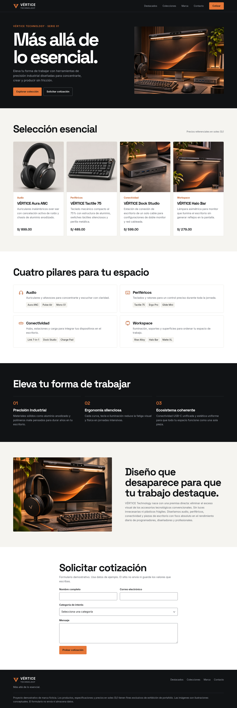
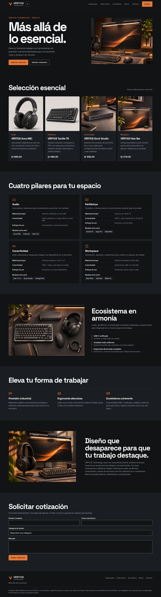
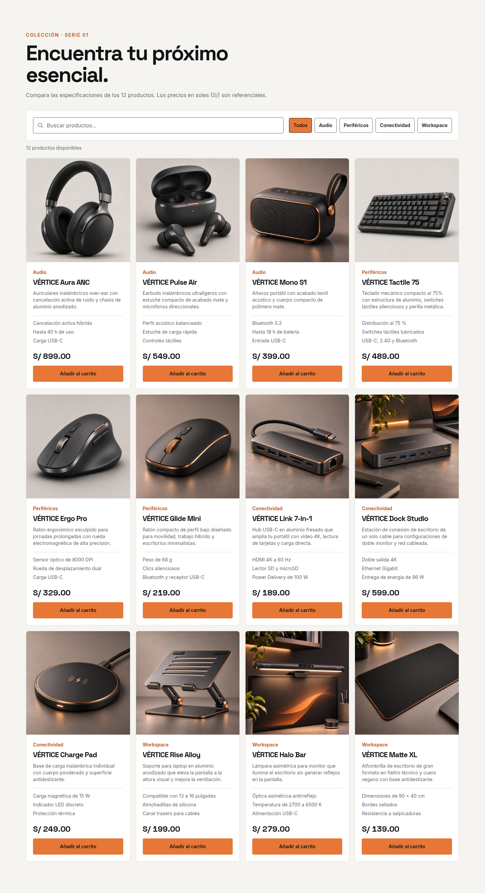

# VÉRTICE Technology

**Core A de DCR Web Studio** · Portafolio de desarrollo web comercial

VÉRTICE Technology es una marca ficticia de audio, periféricos, conectividad y accesorios de escritorio. El proyecto muestra cómo una misma propuesta comercial evoluciona desde una landing estática hasta un catálogo interactivo accesible. Los productos, precios y especificaciones son demostrativos. El formulario y el carrito funcionan como demostraciones locales.

## Tres versiones, una misma marca

| Versión | Funcionalidades | Tecnología | Demo pública |
| --- | --- | --- | --- |
| [V1 · Landing](V1-Landing/) | Presentación comercial, cuatro productos destacados, menú con teclado y cotización demostrativa. | HTML semántico, CSS con BEM, Flexbox y Grid, JavaScript nativo. | [Abrir Landing](https://vertice-landing-153.pages.dev/) |
| [V2 · Professional](V2-Professional/) | Fichas comparativas, editorial «Ecosistema en armonía», tema claro y oscuro y validación accesible por campo. | Tailwind CSS 4.3.5 y Forms 0.5.11, CSS compilado reproducible, JavaScript nativo. | [Abrir Professional](https://vertice-professional.pages.dev/) |
| [V3 · Catalog](V3-Catalog/) | Doce productos, búsqueda por texto y filtros combinables, carrito persistente en céntimos enteros, tema persistente y copia del resumen. | Módulos ES, Fetch API, JSON local, HTML de respaldo, `localStorage`, Tailwind CSS y pruebas con `node:test`. | [Abrir Catalog](https://vertice-catalog.pages.dev/) |

Las tres demos se alojan en proyectos independientes de Cloudflare Pages Free conectados a la rama `main`. Cada proyecto publica el HTML, el CSS compilado y los recursos de su directorio. El historial conserva las entregas aprobadas en `v1.0-vertice`, `v2.0-vertice` y `v3.0-vertice`.

## Capturas reales

| V1 · Landing | V2 · Professional | V3 · Catalog |
| :---: | :---: | :---: |
|  |  |  |
| [Vista móvil](Auditorias/captura-375.png) | [Vista móvil en oscuro](Auditorias/V2/oscuro-375.png) | [Carrito abierto en móvil](Auditorias/V3/carrito-oscuro-375.png) |

## Resultados técnicos

Mediciones de Lighthouse 13.6.0 en Chromium por HTTP local para los cierres aprobados. Los perfiles móvil y escritorio se ejecutaron por separado.

| Versión | Rendimiento móvil / escritorio | Accesibilidad / Buenas prácticas / SEO | LCP móvil / escritorio | Evidencias |
| --- | ---: | ---: | ---: | --- |
| V1 | 96 / 100 | 100 / 100 / 100 | 2,70 s / 0,66 s | [Informe V1](Auditorias/README.md) |
| V2 | 96 / 100 | 100 / 100 / 100 | 2,78 s / 0,70 s | [Informe V2](Auditorias/V2/README.md) |
| V3 | 91 / 100 | 100 / 100 / 100 | 3,45 s / 0,72 s | [Informe V3](Auditorias/V3/README.md) |

V2 y V3 produjeron CSS idéntico entre compilaciones consecutivas. V3 pasó 13 pruebas unitarias y ocho evaluaciones con Axe sin infracciones detectadas. En 48 mediciones de la versión final, que cubrieron ambos temas y demoras controladas de carga, el CLS máximo fue 0,010753. [Pruebas unitarias de V3](Auditorias/V3/node-test.txt) · [Mediciones de CLS](Auditorias/V3/cls-despues.json)

## Ejecutar en local

Clona el repositorio y elige una versión. Los tres directorios ya incluyen el CSS que necesita el navegador. Para abrirlos por HTTP con Python 3:

```sh
git clone https://github.com/Diego4422/Core-A-Vertice.git
cd Core-A-Vertice
python3 -m http.server 8080 --bind 127.0.0.1 --directory V3-Catalog
```

Abre [http://127.0.0.1:8080/](http://127.0.0.1:8080/). Sustituye `V3-Catalog` por `V1-Landing` o `V2-Professional` para servir otra versión.

- **V1** funciona directamente con el HTML y los recursos incluidos.
- **V2** se recompila dentro de su carpeta con `npm ci` y `npm run build:css`.
- **V3** se recompila dentro de su carpeta con `npm ci` y `npm run build`. Usa `npm test` para verificar la lógica. El build regenera el respaldo HTML desde [el catálogo JSON](V3-Catalog/data/productos.json) y después compila el CSS.

## Alcance y limitaciones

- El formulario de cotización no envía ni guarda datos personales. En V3, el carrito guarda solo IDs de productos y cantidades en el navegador. El resumen se copia localmente y WhatsApp permanece desactivado.
- El catálogo de V3 requiere HTTP para sus módulos y su carga JSON. Las doce fichas y sus precios siguen visibles sin JavaScript. Si falla el JSON con el módulo disponible, la búsqueda y el carrito operan sobre el respaldo HTML.
- La verificación de navegador se hizo en Chromium. Las puntuaciones de accesibilidad corresponden a las comprobaciones registradas.

## Autoría y recursos

DCR Web Studio dirigió el proyecto, aprobó los recursos y revisó las entregas. ChatGPT ayudó a consolidar las instrucciones, Gemini apoyó la planificación arquitectónica, Codex implementó y probó el código, y Gemini y Claude realizaron auditorías independientes. Las fotografías de producto y las composiciones editoriales son ilustraciones conceptuales generadas con IA. Las capturas de esta página provienen de ejecuciones reales del sitio en Chromium.

Las fuentes Inter y Space Grotesk se distribuyen en WOFF2 con sus licencias SIL Open Font License 1.1 en cada versión. [Licencia de Inter](V3-Catalog/assets/fonts/OFL-Inter.txt) · [Licencia de Space Grotesk](V3-Catalog/assets/fonts/OFL-Space-Grotesk.txt) · [Documentación del proyecto](Documentacion/)
